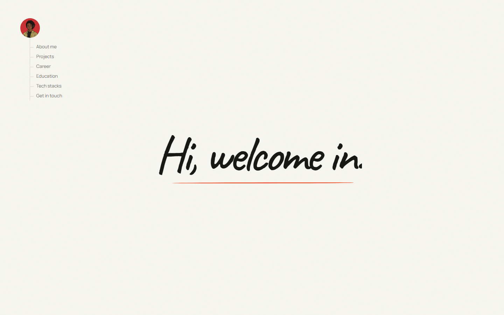

# Kentucky

## Preview



## Branches

- `main` — original repository branch, unchanged
- `2025` — backup of the original portfolio
- `2026` — current portfolio redesign

## Features

- Full-screen navigation between main sections and subcategories
- GitHub-starred project pages with project links and technology stacks
- Career and education timelines
- Responsive contact section
- Reduced-motion support

## Stack

- React 19
- TypeScript
- Vite
- Motion
- Simple Icons

## Run locally

```bash
npm install
npm run dev
```

Open `http://127.0.0.1:5173`.

## Production build

```bash
npm run build
```
